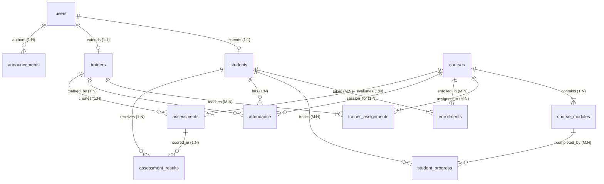

# 🎓 Training Management System (TMS)

A complete, production-ready **Training Management System (TMS)** built with **Node.js**, **Express**, **SQLite**, and **JWT Authentication**, featuring role-based access control for **Students**, **Trainers**, and **Admins**.

---

## 📑 Table of Contents
1. [Key Features](#-key-features)
2. [Database Architecture & Entity Relationships](#-database-architecture--entity-relationships)
3. [Role Capabilities & Permissions](#-role-capabilities--permissions)
4. [Tech Stack](#-tech-stack)
5. [Quick Start & CLI Commands](#-quick-start--cli-commands)
6. [Demo Accounts](#-demo-accounts)
7. [REST API Documentation](#-rest-api-documentation)
8. [Automated Testing](#-automated-testing)

---

## 🚀 Key Features

- **Triple-Role Authentication & Access Control:**
  - `ADMIN`: Full authority over students, trainers, courses, assignments, attendance, assessments, and executive reports.
  - `TRAINER`: Management over assigned courses, student progress tracking, attendance marking, and grading assessments.
  - `STUDENT`: Isolated dashboard displaying personal progress %, enrolled courses, attendance breakdown, assessment scores, and upcoming deadlines.
- **Enterprise Security:**
  - Passwords hashed with `bcryptjs` (salt rounds = 10). Passwords are never stored or logged in plain text.
  - Stateless JSON Web Tokens (`jsonwebtoken`) with expiration.
  - Strict middleware-level Role-Based Access Control (`authorizeRoles`).
  - Parameterized SQLite queries preventing SQL injection attacks.
- **Dual Interface:**
  - **Interactive CLI Terminal**: A rich console application with menus and custom role dashboards.
  - **RESTful API**: Standardized JSON endpoints for all resources.
- **Automated Test Suite**: 31 comprehensive integration tests covering authentication, RBAC boundaries, and CRUD workflows.

---

## 🗄️ Database Architecture & Entity Relationships

The relational schema is implemented in SQLite with `PRAGMA foreign_keys = ON` and `WAL` journal mode.

### Entity Relationship Diagram



### Table Relationships & Purpose

1. **`users`**: Base identity for all system accounts (Admin, Trainer, Student). Stores `name`, `email` (UNIQUE), `password_hash`, `role` (`ADMIN`, `TRAINER`, `STUDENT`), and account `status`.
2. **`students`**: 1:1 extension of `users` for student-specific profile metadata (`student_code` UNIQUE, `phone`).
3. **`trainers`**: 1:1 extension of `users` for trainer-specific profile metadata (`trainer_code` UNIQUE, `specialization`, `phone`).
4. **`courses`**: Academic offerings (`code` UNIQUE, `title`, `description`, `status`).
5. **`course_modules`**: 1:N with `courses`. Structured breakdown of syllabus topics within a course, ordered by `order_index`.
6. **`trainer_assignments`**: M:N junction table between `trainers` and `courses`. Links instructors to their assigned subjects.
7. **`enrollments`**: M:N junction table between `students` and `courses`. Records student enrollment status (`ACTIVE`, `COMPLETED`, `DROPPED`).
8. **`student_progress`**: M:N tracking table between `students` and `course_modules`. Records completion flag (`0` or `1`) and `completed_at` timestamp.
9. **`attendance`**: Daily session attendance (`PRESENT`, `ABSENT`, `LATE`) for each student in a course, marked by the instructing trainer.
10. **`assessments`**: Assignments, quizzes, and exams created for a specific course by an assigned trainer (`max_marks`, `due_date`).
11. **`assessment_results`**: Graded results mapping an assessment to a student with `marks_obtained` and `remarks`.
12. **`announcements`**: System announcements broadcasted by administrators or trainers, targeted by audience (`ALL`, `STUDENT`, `TRAINER`).

---

## 👥 Role Capabilities & Permissions

| Capability | Student | Trainer | Admin |
|:---|:---:|:---:|:---:|
| View Personal Dashboard | ✅ | ✅ | ✅ |
| View Personal Progress & Marks | ✅ | ❌ (Own only) | ✅ |
| View Other Students' Profiles | ❌ | ✅ (Assigned only) | ✅ (All) |
| Mark Student Attendance | ❌ | ✅ (Assigned courses) | ✅ (All) |
| Create Assessments & Enter Marks | ❌ | ✅ (Assigned courses) | ✅ (All) |
| Manage Courses & Modules | ❌ | ❌ | ✅ |
| Create / Deactivate Accounts | ❌ | ❌ | ✅ |
| Assign Trainers & Enroll Students | ❌ | ❌ | ✅ |
| View System Analytics & Reports | ❌ | ❌ | ✅ |

---

## 💻 Tech Stack

- **Runtime:** Node.js (v24.x)
- **Framework:** Express.js (v5.x)
- **Database Engine:** SQLite3 with `better-sqlite3` driver
- **Authentication:** `jsonwebtoken` (JWT) + `bcryptjs`
- **Environment Management:** `dotenv`
- **Testing:** Native `node:test` and `node:assert/strict`

---

## ⚡ Quick Start & CLI Commands

### 1. Launch the Interactive CLI
The interactive CLI provides interactive role dashboards, menus, and actions:
```powershell
npm run cli
```

### 2. Quick Command-Line Dashboard Inspections
You can inspect role dashboards directly from the terminal without manual login:

**Student Dashboard:**
```powershell
node src/cli/index.js --login alice@tms.com Student@123
```

**Trainer Dashboard:**
```powershell
node src/cli/index.js --login john@tms.com Trainer@123
```

**Admin Dashboard:**
```powershell
node src/cli/index.js --login admin@tms.com Admin@123
```

### 3. Launch the REST API Server
Start the HTTP server on port 5000:
```powershell
npm start
```
*(For development with auto-reload: `npm run dev`)*

### 4. Run Automated Test Suite
Execute the 31 end-to-end integration tests:
```powershell
npm test
```

---

## 🔑 Demo Accounts

All passwords are encrypted with bcrypt. The following seed accounts are pre-configured:

| Role | Email | Password | Details |
|:---|:---|:---|:---|
| **ADMIN** | `admin@tms.com` | `Admin@123` | System Administrator |
| **TRAINER** | `john@tms.com` | `Trainer@123` | John Doe (TRN001 - Web Dev) |
| **TRAINER** | `sarah@tms.com` | `Trainer@123` | Sarah Smith (TRN002 - Python & AI) |
| **STUDENT** | `alice@tms.com` | `Student@123` | Alice Johnson (STU001) |
| **STUDENT** | `bob@tms.com` | `Student@123` | Bob Miller (STU002) |
| **STUDENT** | `charlie@tms.com` | `Student@123` | Charlie Brown (STU003) |
| **STUDENT** | `diana@tms.com` | `Student@123` | Diana Prince (STU004) |

---

## 📡 REST API Documentation

### Authentication (`/api/auth`)
- `POST /api/auth/login`: Authenticate email and password, returns JWT token and role routing.
- `GET /api/auth/me`: Retrieve current authenticated profile (`Bearer <token>`).

### Student Module (`/api/student`) — *Requires STUDENT role*
- `GET /api/student/dashboard`: Full student metrics (course progress %, attendance %, marks %, announcements).
- `GET /api/student/courses`: Enrolled courses and module syllabus breakdown.
- `POST /api/student/modules/:id/complete`: Mark a course module as completed.
- `GET /api/student/attendance`: Personal attendance session logs.
- `GET /api/student/assessments`: Upcoming and completed assessment marks.

### Trainer Module (`/api/trainer`) — *Requires TRAINER role*
- `GET /api/trainer/dashboard`: Trainer metrics, assigned student count, low-attendance/low-mark alerts.
- `GET /api/trainer/students`: Students enrolled in trainer's assigned courses.
- `GET /api/trainer/students/:id`: Detailed profile, progress, and performance for an assigned student.
- `GET /api/trainer/attendance`: Filterable attendance logs (`course_id`, `student_id`, `date`).
- `POST /api/trainer/attendance`: Record student attendance (`PRESENT`, `ABSENT`, `LATE`).
- `PUT /api/trainer/attendance/:id`: Update attendance status.
- `GET /api/trainer/assessments`: Assessments created for trainer's courses.
- `POST /api/trainer/assessments`: Create new assessment with max marks and deadline.
- `GET /api/trainer/assessments/:id/results`: View student submissions for an assessment.
- `POST /api/trainer/assessments/:id/marks`: Enter/update marks and remarks for a student.
- `GET /api/trainer/progress`: Course-level completion monitoring across all assigned students.

### Admin Module (`/api/admin`) — *Requires ADMIN role*
- `GET /api/admin/dashboard`: System-wide counts, averages, and trainer workloads.
- `GET /api/admin/reports`: Comprehensive reports on courses, attendance, and student performance.
- `GET /api/admin/students`: List registered students (supports search, sort, pagination).
- `POST /api/admin/students`: Create new student user and profile.
- `PUT /api/admin/students/:id`: Update student information.
- `DELETE /api/admin/students/:id`: Delete or deactivate student.
- `GET /api/admin/trainers`: List trainers and their teaching load.
- `POST /api/admin/trainers`: Create new trainer user and profile.
- `PUT /api/admin/trainers/:id`: Update trainer profile.
- `DELETE /api/admin/trainers/:id`: Remove trainer account.
- `GET /api/admin/courses`: List all courses with module and enrollment counts.
- `POST /api/admin/courses`: Create course with syllabus modules.
- `PUT /api/admin/courses/:id`: Update course status or title.
- `DELETE /api/admin/courses/:id`: Remove course.
- `POST /api/admin/assign-trainer`: Assign trainer to course (`trainer_id`, `course_id`).
- `POST /api/admin/enroll-student`: Enroll student in course (`student_id`, `course_id`).
- `GET /api/admin/attendance`: System-wide attendance query.
- `POST /api/admin/announcements`: Broadcast system notice (`ALL`, `STUDENT`, `TRAINER`).

---

## 🧪 Automated Testing

Run the automated test suite with:
```powershell
npm test
```
**Test Coverage Includes:**
- Admin, Trainer, and Student authentication flows
- Invalid credential rejection (wrong password, missing parameters, nonexistent accounts)
- Token-less request rejection (401 Unauthorized)
- Role Boundary Enforcement (Student accessing Admin -> 403 Forbidden, Trainer accessing Admin -> 403 Forbidden)
- Student data isolation (accessing un-enrolled course modules -> 403 Forbidden)
- Trainer permission boundaries (accessing students outside assigned courses -> 403 Forbidden)
- Attendance marking, assessment creation, and grading workflows
- Admin entity creation, assignments, and cascading record deletion
