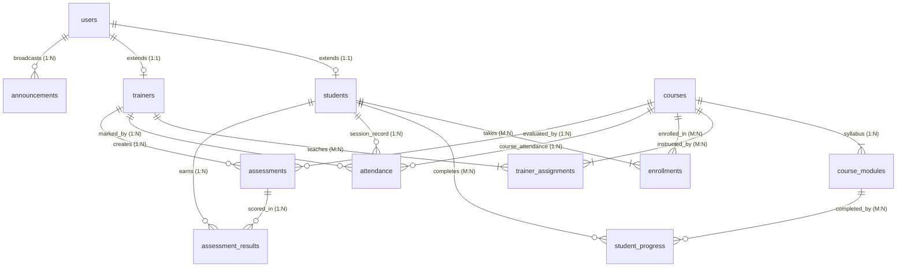

# 🎓 Training Management System (TMS)

A complete, production-grade **Training Management System (TMS)** built with **Node.js**, **Express**, **SQLite**, and **React (Vite)**, supporting **both** a **Modern Browser Web Application** and a **Terminal CLI Application** with strict role-based access control for **Students**, **Trainers**, and **Admins**.

---

## 📑 Table of Contents
1. [Web Application & CLI Architecture](#-web-application--cli-architecture)
2. [Database Architecture & Entity Relationships](#-database-architecture--entity-relationships)
3. [Role Capabilities & Permissions](#-role-capabilities--permissions)
4. [Tech Stack](#-tech-stack)
5. [How to Launch in Google Chrome](#-how-to-launch-in-google-chrome)
6. [Interactive Terminal CLI Usage](#-interactive-terminal-cli-usage)
7. [Demo Accounts](#-demo-accounts)
8. [REST API Documentation](#-rest-api-documentation)
9. [Automated Testing](#-automated-testing)

---

## 🌐 Web Application & CLI Architecture

The project simultaneously supports **both** interfaces on top of the same SQLite database and business logic:

```text
               ┌────────────────────────────────────────────────────────┐
               │              Training Management System                │
               └──────────────────────────┬─────────────────────────────┘
                                          │
                  ┌───────────────────────┴───────────────────────┐
                  ▼                                               ▼
     ┌────────────────────────┐                      ┌────────────────────────┐
     │   Modern Web Browser   │                      │  Terminal CLI Client   │
     │  (Google Chrome / Edge)│                      │  (PowerShell / Bash)   │
     └────────────┬───────────┘                      └────────────┬───────────┘
                  │                                               │
                  │   HTTP REST API (JWT Authenticated)           │   Direct ORM/SQL
                  ▼                                               ▼
     ┌────────────────────────────────────────────────────────────────────────┐
     │                     Express.js Backend & API Server                    │
     │     - Authentication & bcrypt Password Hashing                         │
     │     - RBAC Authorization Middleware (ADMIN, TRAINER, STUDENT)          │
     │     - Student, Trainer, Admin, Attendance, & Assessment Controllers    │
     └────────────────────────────────────┬───────────────────────────────────┘
                                          │
                                          ▼
     ┌────────────────────────────────────────────────────────────────────────┐
     │                      SQLite3 Relational Database                       │
     │       (12 Normalized Tables, Foreign Keys ON, WAL Journal Mode)        │
     └────────────────────────────────────────────────────────────────────────┘
```

---

## 🗄️ Database Architecture & Entity Relationships

The relational schema is implemented in SQLite with `PRAGMA foreign_keys = ON` and `WAL` mode.



### Table Relationships & Purpose
1. **`users`**: Base identity for all accounts (`id`, `name`, `email` UNIQUE, `password_hash`, `role` (`ADMIN`, `TRAINER`, `STUDENT`), `status`).
2. **`students`**: 1:1 extension of `users` for student metadata (`student_code` UNIQUE, `phone`).
3. **`trainers`**: 1:1 extension of `users` for instructor metadata (`trainer_code` UNIQUE, `specialization`, `phone`).
4. **`courses`**: Academic offerings (`code` UNIQUE, `title`, `description`, `status`).
5. **`course_modules`**: 1:N with `courses`. Structured breakdown of syllabus topics.
6. **`trainer_assignments`**: M:N junction table between `trainers` and `courses`.
7. **`enrollments`**: M:N junction table between `students` and `courses`.
8. **`student_progress`**: M:N tracking table between `students` and `course_modules`.
9. **`attendance`**: Daily session attendance (`PRESENT`, `ABSENT`, `LATE`) marked by trainers.
10. **`assessments`**: Quizzes, exams, and projects created for a course by an assigned trainer.
11. **`assessment_results`**: Graded results mapping an assessment to a student with marks and remarks.
12. **`announcements`**: Broadcast notices targeted by audience (`ALL`, `STUDENT`, `TRAINER`).

---

## 👥 Role Capabilities & Permissions

| Capability | Student | Trainer | Admin |
|:---|:---:|:---:|:---:|
| View Personal Dashboard | ✅ | ✅ | ✅ |
| View Personal Progress & Marks | ✅ | ❌ (Own only) | ✅ |
| View Other Students' Profiles | ❌ | ✅ (Assigned only) | ✅ (All) |
| Mark Student Attendance | ❌ | ✅ (Assigned courses) | ✅ (All) |
| Create Assessments & Enter Marks | ❌ | ✅ (Assigned courses) | ✅ (All) |
| Manage Courses & Modules | ❌ | ❌ | ✅ |
| Create / Deactivate Accounts | ❌ | ❌ | ✅ |
| Assign Trainers & Enroll Students | ❌ | ❌ | ✅ |
| View System Analytics & Reports | ❌ | ❌ | ✅ |

---

## 💻 Tech Stack

- **Backend:** Node.js (v24.x) + Express.js (v5.x)
- **Frontend:** React (v19.x) + Vite + Plus Jakarta Sans + Lucide Icons + Custom SVG Data Visualizations
- **Database Engine:** SQLite3 via `better-sqlite3`
- **Security:** `bcryptjs` (salt rounds = 10) + `jsonwebtoken` (JWT)
- **Testing:** Native `node:test` + `node:assert/strict`

---

## 🚀 How to Launch in Google Chrome

To run the complete web application:

1. Open your terminal in `C:\Users\praka\OneDrive\Desktop\CLI\training-management-system`.
2. Start the unified server:
   ```powershell
   npm start
   ```
3. Open **Google Chrome** (or your preferred browser) and navigate to:
   ```text
   http://localhost:5000
   ```
4. You will see the **TMS Enterprise Login Portal**.
   - Use the **One-Click Instant Demo Login buttons** at the bottom of the login card to jump immediately into **Admin**, **Trainer**, or **Student** mode!
   - You can also switch roles on the fly using the **"Switch Role"** toolbar in the top navigation bar.

*(Optional Development Mode: `npm run client` launches Vite with Hot Module Reloading on `http://localhost:3000`).*

---

## 🖥️ Interactive Terminal CLI Usage

The terminal-based CLI remains 100% active and operational:

### 1. Launch Interactive CLI Menu
```powershell
npm run cli
```

### 2. Direct One-Line Role Dashboard Inspections
```powershell
# Student Dashboard
node src/cli/index.js --login alice@tms.com Student@123

# Trainer Dashboard
node src/cli/index.js --login john@tms.com Trainer@123

# Admin Dashboard
node src/cli/index.js --login admin@tms.com Admin@123
```

---

## 🔑 Demo Accounts

All passwords are encrypted with bcrypt:

| Role | Email | Password | Name & Details |
|:---|:---|:---|:---|
| **ADMIN** | `admin@tms.com` | `Admin@123` | System Administrator |
| **TRAINER** | `john@tms.com` | `Trainer@123` | John Doe (`TRN001` - Full-Stack Web) |
| **TRAINER** | `sarah@tms.com` | `Trainer@123` | Sarah Smith (`TRN002` - Python & Data Science) |
| **STUDENT** | `alice@tms.com` | `Student@123` | Alice Johnson (`STU001` - CS101, DB301) |
| **STUDENT** | `bob@tms.com` | `Student@123` | Bob Miller (`STU002` - Low marks alert demo) |
| **STUDENT** | `charlie@tms.com` | `Student@123` | Charlie Brown (`STU003` - DS201) |
| **STUDENT** | `diana@tms.com` | `Student@123` | Diana Prince (`STU004` - High performer demo) |

---

## 📡 REST API Documentation

### Authentication (`/api/auth`)
- `POST /api/auth/login`: Authenticate email and password, returns JWT token and role routing.
- `GET /api/auth/me`: Retrieve current authenticated profile (`Bearer <token>`).

### Student Module (`/api/student`) — *Requires STUDENT role*
- `GET /api/student/dashboard`: Full student metrics (course progress %, attendance %, marks %, announcements).
- `GET /api/student/courses`: Enrolled courses and module syllabus breakdown.
- `POST /api/student/modules/:id/complete`: Mark a course module as completed.
- `GET /api/student/attendance`: Personal attendance session logs.
- `GET /api/student/assessments`: Upcoming and completed assessment marks.

### Trainer Module (`/api/trainer`) — *Requires TRAINER role*
- `GET /api/trainer/dashboard`: Trainer metrics, assigned student count, low-attendance/low-mark alerts.
- `GET /api/trainer/students`: Students enrolled in trainer's assigned courses.
- `GET /api/trainer/students/:id`: Detailed profile, progress, and performance for an assigned student.
- `GET /api/trainer/attendance`: Filterable attendance logs (`course_id`, `student_id`, `date`).
- `POST /api/trainer/attendance`: Record student attendance (`PRESENT`, `ABSENT`, `LATE`).
- `PUT /api/trainer/attendance/:id`: Update attendance status.
- `GET /api/trainer/assessments`: Assessments created for trainer's courses.
- `POST /api/trainer/assessments`: Create new assessment with max marks and deadline.
- `GET /api/trainer/assessments/:id/results`: View student submissions for an assessment.
- `POST /api/trainer/assessments/:id/marks`: Enter/update marks and remarks for a student.
- `GET /api/trainer/progress`: Course-level completion monitoring across all assigned students.

### Admin Module (`/api/admin`) — *Requires ADMIN role*
- `GET /api/admin/dashboard`: System-wide counts, averages, and trainer workloads.
- `GET /api/admin/reports`: Comprehensive reports on courses, attendance, and student performance.
- `GET /api/admin/students`: List registered students (supports search, sort, pagination).
- `POST /api/admin/students`: Create new student user and profile.
- `PUT /api/admin/students/:id`: Update student information.
- `DELETE /api/admin/students/:id`: Delete or deactivate student.
- `GET /api/admin/trainers`: List trainers and their teaching load.
- `POST /api/admin/trainers`: Create new trainer user and profile.
- `PUT /api/admin/trainers/:id`: Update trainer profile.
- `DELETE /api/admin/trainers/:id`: Remove trainer account.
- `GET /api/admin/courses`: List all courses with module and enrollment counts.
- `POST /api/admin/courses`: Create course with syllabus modules.
- `PUT /api/admin/courses/:id`: Update course status or title.
- `DELETE /api/admin/courses/:id`: Remove course.
- `POST /api/admin/assign-trainer`: Assign trainer to course (`trainer_id`, `course_id`).
- `POST /api/admin/enroll-student`: Enroll student in course (`student_id`, `course_id`).
- `GET /api/admin/attendance`: System-wide attendance query.
- `POST /api/admin/announcements`: Broadcast system notice (`ALL`, `STUDENT`, `TRAINER`).

---

## 🧪 Automated Testing

Run the automated test suite with:
```powershell
npm test
```
**Test Coverage (31 Passing Tests):**
- Admin, Trainer, and Student authentication flows
- Invalid credential rejection (wrong password, missing parameters, nonexistent accounts)
- Token-less request rejection (401 Unauthorized)
- Role Boundary Enforcement (Student accessing Admin -> 403 Forbidden, Trainer accessing Admin -> 403 Forbidden)
- Student data isolation (accessing un-enrolled course modules -> 403 Forbidden)
- Trainer permission boundaries (accessing students outside assigned courses -> 403 Forbidden)
- Attendance marking, assessment creation, and grading workflows
- Admin entity creation, assignments, and cascading record deletion
